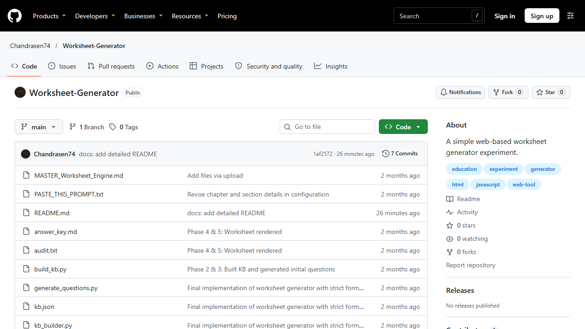

# Worksheet-Generator

**Repository:** https://github.com/Chandrasen74/Worksheet-Generator



## Overview
`Worksheet-Generator` is a Python/HTML project.
- **Primary language:** HTML
- **Languages detected:** Python, HTML
- **Stack/tech:** Python, HTML

## Language & stack details
- Languages: Python, HTML
- Frameworks/tools/libraries: Python, HTML

## How to install & run
### Prerequisites
- [Python 3](https://www.python.org/downloads/) installed

### Setup & run
```bash
git clone https://github.com/Chandrasen74/Worksheet-Generator.git
cd Worksheet-Generator
python build_kb.py
```

## Repository structure (top-level/sample)
- `MASTER_Worksheet_Engine.md`
- `PASTE_THIS_PROMPT.txt`
- `README.md`
- `answer_key.md`
- `audit.txt`
- `build_kb.py`
- `generate_questions.py`
- `kb.json`
- `kb_builder.py`
- `knowledge_base.json`
- `knowledge_base.py`
- `logo_green_on_white.png`
- `process_logo.py`
- `questions.json`
- `render_worksheet.py`
- `screenshot.png`
- `worksheet.html`

## Status
Documented with screenshot, language/stack details, and setup instructions as part of a profile-wide README update.
